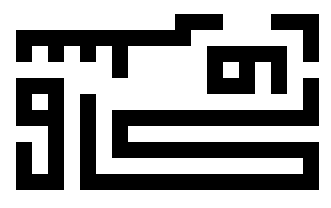
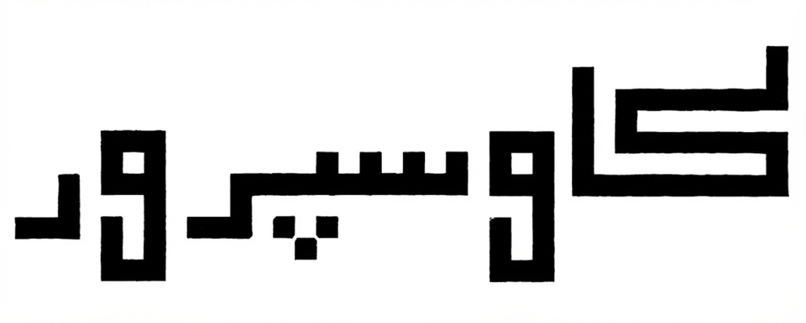
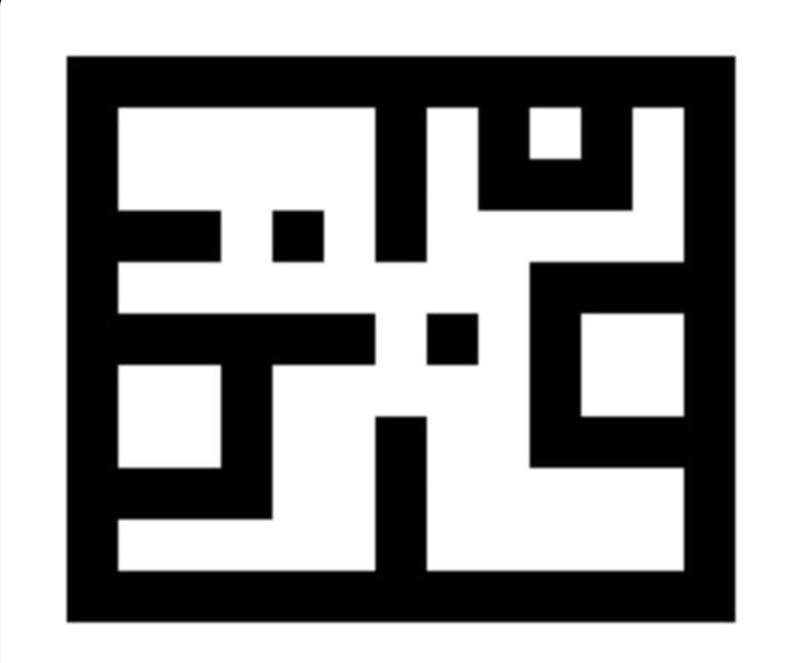
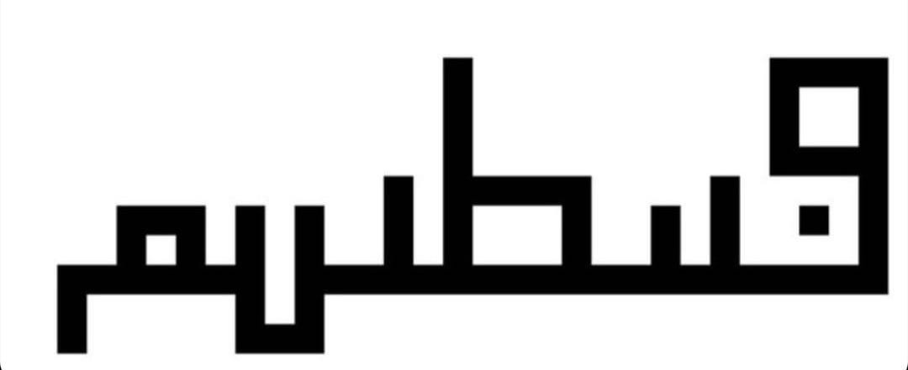

::: {.calligraphy-page}

I do not think there is anything less expected than finding a linguist being drawn to patterns.

If you travel across Central Asia, or even look at the pictures of palaces that Seljuks and Central Asian dynasties built, you would see a lot of structures that are geometric to an extreme, where the abstraction hijacks the building.

::: {.install-figure .install-reference}

  

  <h4>architectural reference</h4>
  
Geometric inscription used as structure and ornament in Seljuk-era design language.

  
<a href="https://x.com/PaulMMCooper/status/944203296704749568" target="_blank" rel="noopener">Source: Paul M. Cooper (@PaulMMCooper), shared on X</a>

:::

::: {.install-figure .install-reference}

  

  <h4>kilim motif reference</h4>
  
An <em>elibelinde</em> kilim motif, included here as a geometric counterpoint to architectural inscription patterns.

  
<a href="https://commons.wikimedia.org/wiki/File:Elibelinde2.svg" target="_blank" rel="noopener">Source: Wikimedia Commons (File: Elibelinde2.svg)</a>

:::

These surfaces also feel very close to Kilim patterns, which are also geometric and often feature repeated motifs. These motifs, along with same principles, of course appear in many parts around the world. But what is interesting about the Seljuk and Central Asian architecture is that they often incorporate <strong>calligraphy</strong> into their buildings. The writing was not to be read, but to be seen as part of the design.

These inscriptions below are not for reading, even though they technically have a meaning. They are motifs that are important to me. These inscriptions, very much like the feelings they were response to, exists in multiple formats. A <strong>cenin</strong>[^cenin] version, where it is hard to understand and handle. And a <strong>string</strong> version where the same structure is drawn as a more continuous thread and ready to be engaged.

## kaosperver

::: {.install-figure}

  

  <h4>kaosperver -- cenin</h4>
  
Where corners hold tension and the structure defines the word as an object.

:::

::: {.dict-entry}
kaosperver(coined adj./n.)

meaning: chaos-loving; someone drawn to disorder.

formation: Turkish <strong>kaos</strong> + Persian-origin suffix <strong>-perver</strong> ("one who fosters/loves," as in <em>vatanperver</em>).

etymology note: <strong>kaos</strong> goes back to Greek <em>khaos</em> ("void, abyss"), transmitted through European languages before entering modern Turkish usage.

:::

::: {.install-figure}

  

  <h4>kaosperver -- string</h4>
  
Stretched into a thread, deliberately trading block tension for line and flow.

:::

## fırtınam

::: {.install-figure}

  

  <h4>fırtınam -- cenin</h4>
  
A contained <em>fırtınam</em>, held in a compact geometric frame despite the word’s meaning.

:::

::: {.dict-entry}
fırtınam(noun phrase, 1st person possessive)

meaning: "my storm."

formation: Turkish <strong>fırtına</strong> ("storm") + possessive suffix <strong>-m</strong> ("my"), often written without Turkish diacritics in Latin text.

etymology note: <strong>fırtına</strong> is generally traced to Mediterranean borrowings from Italian/Venetian <strong>fortuna</strong> (ultimately Latin <strong>fortuna</strong>), likely via Greek and Ottoman Turkish forms such as <em>furtuna/fırtına</em>.

:::

::: {.install-figure}

  

  <h4>fırtınam -- string</h4>
  
Leans into movement and carries a windswept cadence while preserving a Kufic skeleton.

:::

:::

[^cenin]: In Turkish, *cenin* means "fetus/embryo." 
