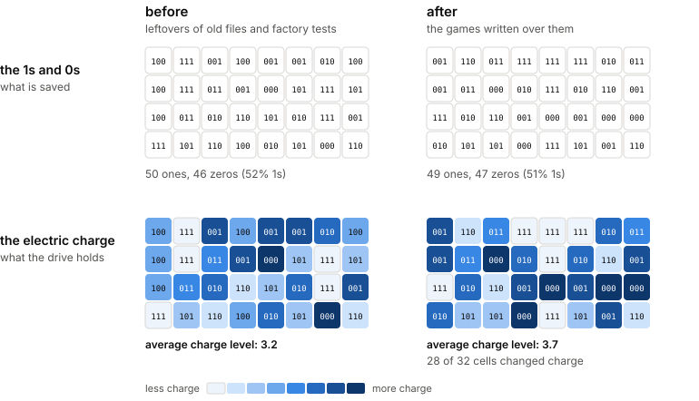
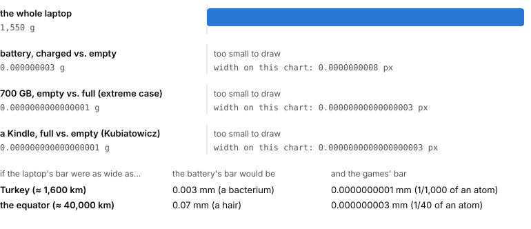
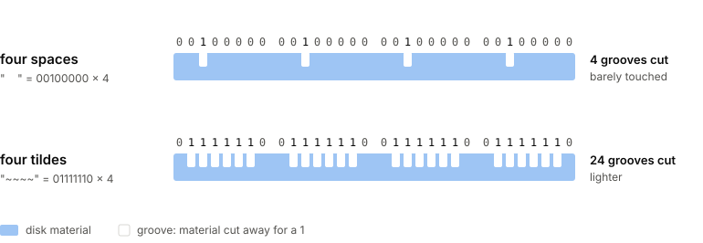

Every class at UMD starts with reading Marr. One of the essential things to take from Marr is that a system can be understood at separate levels, which are related to each other but only loosely coupled. Specifying or explaining one level does not require you to characterize the others. This is bread and butter for people who want to argue for their own special land, draw its borders, and limit the questions they have to study.

I completely agree that the levels are distinct and that you can work on one level without specifying another. **However, I want to push back on one aspect of this: how easily it frees one from the sins of the other levels.** Marr himself points out that assumptions at one level should constrain the others. I am also not the first to point this out, or fight against it. The 'autonomy thesis', i.e. we can study cognition with little or no attention to its neural basis 'has outlived its usefulness' ([Fitch, 2014, p. 332](https://doi.org/10.1016/j.plrev.2014.04.005)). In this short post, my aim is a lot smaller than getting published in Physics of Life Reviews. I just want to give one small, funny example of how dumb it can sound when you fully free yourself from the other levels.

Okay, so my computer weighs approximately 1.55 kg, and it has many great things about itself, but most importantly, right now it has somewhere close to 700 GB of free space on its disk. Imagine I download a bunch of games and fill the disk to the brim, until there is no space left to store even one more character in a random .txt file. **Does my computer weigh more now, or microspocally the same?** And does the answer have anything to do with how we decided to implement information in our drives?

Before reading on, think about this for a bit. The short answer for "Does representing data weights more" is no, but the effort of representing it eventually changes the weight ever slightly. But then again that is not due to representation.

.

.

.

.

To many of us, the answer is clearly no. It is all 1s and 0s. You are only changing numbers, so why should the weight of the actual thing change, right?

And at the level of 1s and 0s, this is a good argument. Whatever is on my disk is roughly half 1s and half 0s, before and after: files are compressed, disks are encrypted, and the drive scrambles everything anyway.

But the drive does not store 1s and 0s. It stores electric charge, and different charge levels hold slightly different amounts of energy. My empty 700 GB is not empty either; it is full of random leftovers. Filling it keeps the 1s and 0s at 50/50, but shuffles which cell holds how much charge, so the total energy, and with it the weight, shifts a tiny bit, up or down.

How much does it really weigh? Even in the extreme case, a completely empty disk filled to the brim, it is something like 0.0000000000000001 g ([Kubiatowicz, 2011](https://www.nytimes.com/2011/10/25/science/25qna.html), scaled to my 700 GB). Charging my battery changes the weight about ten million times more, so any scale will just tell you about my battery, and not the data stored.

So, technically, the weight changes a tiny bit. But not because of the representation or the 1s and 0s. They are 50/50 either way. It changes because of how the drive physically stores them. You cannot see or understand it if you only care about your representations, i.e. 1s and 0s, or your measurement, i.e. weight.

So, why am I even nerding out about this? Imagine you live in the year 3000. The apocalyptic wars have already happened. While you are hunting the new ten-eyed deer, you come across an ancient relic: an agentic computer built in 2030, still running on solar power. It talks to you. It interacts with you. It learns about you and stores information. You and your family protect this thing with your lives for decades.

Now it is the year 3300. Scientists owe a lot to this machine for its help in rebuilding the world, and they, mostly post-apocalyptic linguists, want to know more about how it works and how it learns. They do not know that computers encode information as 1s and 0s. They do have scales, and they can observe many other things about the computer. In principle, there is even a signal for them: the machine's weight shifts a tiny bit as it stores things. They try many different manipulations, and cannot figure out how sensitive it is the weight to the information the computer is fed. But they cannot use it. The difference is buried under the battery charge, and even with perfect scales, they could not make sense of it without knowing what the encoding looks like: that the data is roughly half 1s and half 0s, that the controller scrambles it, and that each charge level holds a different amount of energy. Even if they found another machine with a single memory cell and saw a weight difference there, it would not teach them much about this machine, because it says nothing about how a whole population of information is encoded. What they can learn at the implementation level depends on what they know about the representation.

There is an alternative version. Imagine another computer where the storage and the complexity of things stored in this computer is associated with the information in it. This computer writes its 1s and 0s like an old record: every 1 is a tiny groove cut into the disk, and every 0 is left untouched. Nothing is compressed, scrambled, or erased, so the more it stores, the lighter it gets, and how much lighter depends on what it stores. For this computer, the scientists' scales work beautifully: they could tell how much it learned, and even something about what it learned, just by measuring it. Whether the method of observation here was well-suited was decided by how the information is implemented in the first place.

Or take an old hard disk taht we used to have. There, an information bit is a tiny magnetized region on a spinning platter, pointing one way or the other. In this case, either directions cost approximately the same energy. Deleting a file does not erase anything, just changes some direction in the disk. The free space is already half 1s and half 0s. Filling it with games files turns one random pattern to another. Practically for measurements nothing changes. In this case, not even the energy. So the scales will find nothing, no matter how good they are.

And a computer case is really the easy one. It should be obvious to you now that the initial assumptions you will have regarding what is the cost of storing a data will lead you one way or another about the expectations you might have for the observations. In this simple computer case, the hardware is not dynamic, it is fixed eternally, as well as the software that runs on it. THINK ABOUT BIOLOGY NOW. Fitch (2014) argues that for brains even this split is misleading: neurons change their form when we learn, so 'the mind is not a program running on the hardware of the brain.' If you cannot ignore the implementation of a laptop or representation of the information 1s and 0s, you can ignore it even less for a brain.

So, next time you defend an indefensible position about representations or algorithms, think about Marr twice. He is not a get-out-of-jail-free card for all your sins.
