After my small BA in Translation Studies, which never required things like LaTeX, I found myself in Linguistics and the in the
Sisyphus-like business of drawing syntax trees. As it is the case with most, I first tried the "Font" in word, then websites like [RSyntaxTree](https://yohasebe.com/rsyntaxtree/) or [jsSyntaxTree](https://ironcreek.net/syntaxtree/). And then eventually, and probably quite fast, you find yourself in the unwelcoming arms of $\LaTeX$. Not because you really like the fancy trees or got bored of copy-pasting trees. But mainly because of glossing, and numbered examples. But with glossing comes qTree, forest, tikz, and bunch of \hfull errors, and waiting time for recompile.

It got even more annoying when I started doing experiments. Copy-pasting trees left its places to copy-pasting means, and standard errors. Putting the updated plots again and again, with every little change. That's when some of us started moving away from $\LaTeX$ to Rmarkdown. I have to say, Rmarkdown is still my favorite thing, though I mainly started using Quarto. Both allow you to embed code blocks, automatically generate inline texts from your Rscript, and automatically update everything experiment related.

Though it is always messy how to integrate linguistic examples, and cross-references with quarto. And there are always bugs. Moreover, it just ended up becoming a fancy wrapper for $\LaTeX$. The dead wait time for every compilation was still there.

Recently, I started mainly working on Typst. Typst shares many things that Rmarkdown or Quarto has, like using markdown-y syntax in writing. One can also opt-out of $\LaTeX$ and use Quarto as a wrapper for Typst as well. Initially the support for linguistic-related stuff was very limited. So, I only used it for small writing projects and posters. But these days, the linguistic related support got immensely better. So, recently I completely switched to using Typst.

One thing that was amazing for me is that Typst can real-life update everything you do. So, there is literally no dead time with what you are writing and what you are seeing in the compiled PDF. Another very important thing for me was that the error messages are actualy human friendly, unlike $\LaTeX$'s cryptic messages. You also do not need to give away your 5 GB disk space to $\LaTeX$, which is quite important when you are a grad student who wants to do writing on their own macbook air and not overleaf. However, more importantly, you can have insanely simple scripting language that allows ifelse, for loops, arrays, dictionaires, and many other operators.

Oh before I forget, unlike $\LaTeX$, Typst can you give HTML, PDF, and DOCX, as well. Imagine how journal papers can look better and faster with this, if they have not forced to go back and forth with manual PDF-HTML conversions.

So, in my head, it was a free real estate for procrastination.

I recently realized though, I am not alone in trying to escape from $\LaTeX$. Almost everyone hates it and everyones is forced to use it. So, I started to write a small guide. It is not complete yet, but I am going to share some parts of it here. Hopefully, it will be completely available soon here: ....githublink.... Right now, this github only has semantic-related stuff, which is because the project I was involved while doing the transition was based on Focus Semantics.

If you know enough LaTeX to compile a handout on overleaf and you have never written a line of actual code, you can easily understand this page. And if you have never used $\LaTeX$, but wanted to learn something like it, this could be a bit difficult for you, however, I suggest you just watch a very simple youtube video on Typst first, and then you are good to go.

You can copy every code block, paste it, compile it, and you get the picture next to it. Those pictures are Typst's own output dropped straight into this page, not screenshots of an editor.

<!--
Incorprote the writing below to upstairs:

The first is the compile loop. In LaTeX I edit, compile, wait, look at the PDF, fix one bracket, compile again. [Typst](https://typst.app/) recompiles while I type, so the preview is always the current state of the file. On a semantics handout with three trees and six derivations, that difference is the whole workday.

The second is that a preamble stops being a junk drawer. In LaTeX, when I want denotation brackets I write `\newcommand{\den}[1]{\llbracket #1 \rrbracket}` and then never touch it again, because editing it means remembering how `#1` and expansion work. In Typst the same thing is an ordinary function, in the same language as the rest of the document, and I can read it six months later.
The third is the one I care most about, and it is why this post looks the way it does. Typst is not locked to paper. Every figure below is a real `.svg` that Typst produced from the code next to it:

```bash
typst compile figure.typ figure.svg
```

There is also a genuine HTML target, `typst compile paper.typ paper.html --format html`, which is still experimental: when I tried it on these examples, the `eggs` grid layout was dropped with a warning, so example numbering came out wrong. It will get there.


And that is the argument for the field switching. Right now a linguistics paper is a two-column PDF, and the "web version" on the journal site is that same PDF in a frame. Our data is examples, glosses, trees, tableaux, and audio, and all of it is flattened into a page image you cannot click, search, zoom, or link into. If journals took Typst source instead of LaTeX source, example (14) could be a link, a tree could be vector graphics that stay sharp at any zoom, a gloss could align in a browser, and a stimulus could play. None of that is exotic. It is just what happens when the source format is not built on the assumption that the destination is a sheet of paper.

The honest cost: the ecosystem is younger. Some things you get free in LaTeX, like a journal's `.cls` file, do not exist yet. I say more about that at the end. -->


## Basics

### What you need before anything else

You have two options, and neither requires installing a distribution the size of TeX Live.

**Option 1, nothing to install.** Go to [typst.app](https://typst.app), make a free account, start a blank document. It is a web editor with the preview on the right, exactly like overleaf. This is the option I would pick if you just want to see what this is about.

**Option 2, on your machine.** Install the app from [typst.app/download](https://typst.app/download), or if you are comfortable with a terminal, `brew install typst` on a Mac. If you use VS Code, install the extension called **Tinymist Typst**, open a `.typ` file, and you get the same live preview locally.

Either way, a Typst document is one file ending in `.typ`. There is no `.aux`, no `.bbl`, no build directory, and nothing to clean up.

One thing that surprises people coming from LaTeX: packages are not installed. When your file says `#import "@preview/eggs:0.6.0": *`, Typst downloads that exact version the first time you compile and caches it. Nothing to run, and the version number lives in your document, so the file still compiles the same way in two years.

### Four things about the notation, and then you can read anything

This is the part that takes twenty minutes, and after it the rest is vocabulary.

**1. Plain text is plain text.** There is actually no `\begin{document}`. You type your prose whereever you want and it appears. Formatting uses single characters very similar to markdown, instead of commands: `*bold*` is bold, `_italic_` is italic, `= Introduction` is a section heading, `== Subsection` is a subsection, and a line starting with `-` is a bullet.

**2. `#` means "this is a command."** Anything that starts with `#` works as an instruction/code: For example, instead of writing 'Hello', you can also write `#text(size: 14pt)[Hello]` to specify a single words text size.

**3. Square brackets hold content, parentheses hold settings.** In `#text(size: 14pt)[Hello]`, the parentheses take named options and the brackets take the text they apply to. Once you see it, every function in every package reads the same way. It feels more code-y than $\LaTeX$ and sometimes it might get a bit too much.

**4. `#set` and `#let`.** `#set` changes a default for everything after it, meanwhile `#let` defines something new, simialr to `\newcommand{}`.

Here is a very simple complete document. The first four lines sets the relevant settings for the page, then you just write. If we wrote some of the text above the settings, the settings would start applying after the written text.

::::: {.column-page}
:::: {.grid}
::: {.g-col-12 .g-col-lg-6}
```typst
#set page(paper: "us-letter", margin: 1in)
#set text(font: "Cascadia Mono", size: 11pt)
#set par(justify: true)
#set heading(numbering: "1.1")

= Introduction

Typst uses *bold* and _italic_ with single characters. A list needs no
environment:

- focus
- alternatives
```
:::
::: {.g-col-12 .g-col-lg-6}
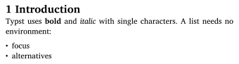{width=100%}
:::
::::
:::::

Here is the table that shows Typsty counterparts for relevant $\LaTeX$ commands.

| LaTeX | Typst |
|---|---|
| `\textbf{x}` | `*x*` |
| `\emph{x}` | `_x_` |
| `\section{X}` | `= X` |
| `\begin{itemize}\item a\end{itemize}` | `- a` |
| `\usepackage{...}` | `#import "@preview/...": *` |
| `\newcommand{\f}[1]{...}` | `#let f(x) = ...` |
| `\label{a}` / `\ref{a}` | `<a>` / `@a` |
| `$\lambda x . P(x)$` | `$lambda x . P(x)$` |
| `\llbracket X \rrbracket` | `$bracket.l.stroked X bracket.r.stroked$` |


### The top of your file

Everything below in this short tutorial assumes that you have these lines at the top of your documents, so paste them once and forget them. The imports are the packages. Unlike $\LaTeX$, you can choose what to import from a package. `: *` imports everything, or you can specific as in `: syntree, tree, listtree`, which also brings the relevant dependencies as well. and the `#let` lines are the three commands I actually use in a semantics paper.

```typst
#import "@preview/eggs:0.6.0": *
#import abbreviations: nom, acc, pst, q
#show: eggs

#import "@preview/syntree:0.3.1": syntree, tree, listtree
#import "@preview/larrow:1.2.0": label-arrow, arrow-label

#let sem(x) = $lr(bracket.l.stroked #x bracket.r.stroked)$
#let lam(v, body) = $lambda #v . thin #body$
#let ty(..args) = {
  let a = args.pos()
  $chevron.l #a.join($, $) chevron.r$
}
```

`#show: eggs` is the line that switches on numbered examples. It has to be there once, near the top, and after that `#example[...]` works everywhere.

## Ling examples

### Numbered examples and judgments

`#example[...]` is your `\begin{exe}`. Numbered sub-items with `+` become (a), (b), (c) on their own. Judgment marks go at the front of the line, escaped with a backslash, and `eggs` pulls them into the margin so the sentences still line up.

::::: {.column-page}
:::: {.grid}
::: {.g-col-12 .g-col-lg-6}
```typst
#example[
  + Heidi ate the döner.
  + \*Ate Heidi döner the.
  + \?The döner Heidi ate.
  + \%Heidi the döner ate.
  #ex-label(<doner>)
]

As shown in @doner, ...
```
:::
::: {.g-col-12 .g-col-lg-6}
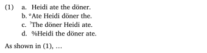{width=100%}
:::
::::
:::::

Cross-references work like `\label` and `\ref`: `#ex-label(<doner>)` inside the example, then `@doner` anywhere in the text. For sub-examples there is `#ex-ref(<doner:a>)` for (1a) and `#ex-ref(<doner:a>, <doner:b>)` for (1a--b).

### Glosses

Inside an example, lines starting with `-` are read as a gloss and aligned word by word. The catch, and it is the single most common thing to get wrong: **words are separated by two or more spaces.** One space is a space inside a word.

Leipzig abbreviations come from the `abbreviations` import and render in small caps on their own.

::::: {.column-page}
:::: {.grid}
::: {.g-col-12 .g-col-lg-6}
```typst
#example[
  - Heidi  döner-i     ye-di=mi?
  - Heidi  döner-#acc  eat-#pst.3#smallcaps[sg]=#q
  'Did Heidi eat the döner?'
]
```
:::
::: {.g-col-12 .g-col-lg-6}
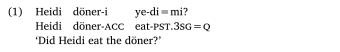{width=100%}
:::
::::
:::::

## Syntax

### Trees

For bracket notation, [`syntree`](https://typst.app/universe/package/syntree/) takes the brackets you would have typed into `qtree` anyway. One version note, because it will cost you an afternoon otherwise: 0.3 takes the tree as content, in square brackets after the settings. Code you find on the web with the tree as a quoted string, `syntree(..., "[S ...]")`, is 0.2 and will not compile against 0.3.

::::: {.column-page}
:::: {.grid}
::: {.g-col-12 .g-col-lg-6}
```typst
#example[
  #syntree(
    nonterminal: (font: "Charis SIL"),
    terminal: (font: "Charis SIL", style: "italic"),
    child-spacing: 2em,
    layer-spacing: 2.3em,
  )[
    [S [NP [D the] [N linguist]] [VP [V runs]]]
  ]
]
```
:::
::: {.g-col-12 .g-col-lg-6}
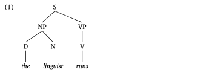{width=100%}
:::
::::
:::::

A triangle over a constituent you are not analysing is one character: `^` in front of the label. On the `tree()` function the same thing is `roof: true`.

::::: {.column-page}
:::: {.grid}
::: {.g-col-12 .g-col-lg-6}
```typst
#syntree(child-spacing: 1.6em)[
  [S [NP [D the] [N linguist]] [^VP likes typst a lot]]
]

#tree([S],
  tree([NP], tree([D], [the]), tree([N], [linguist])),
  tree([VP], [likes typst a lot], roof: true),
  child-spacing: 1.6em,
)
```
:::
::: {.g-col-12 .g-col-lg-6}
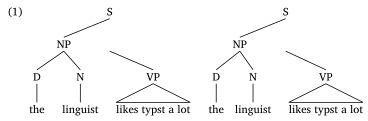{width=100%}
:::
::::
:::::

Counting brackets on a twelve-node tree is nobody's idea of a good afternoon, so there is a third syntax. `listtree` reads an indented bullet list as the tree, and the three functions nest inside each other freely: write the skeleton as a list and paste a `syntree` bracket string in for one subtree if that subtree is small enough to read.

::::: {.column-page}
:::: {.grid}
::: {.g-col-12 .g-col-lg-6}
```typst
#example[
  #listtree(terminal: (style: "italic"), child-spacing: 1.4em)[
    - CP
      - #[DP#sub[i]]
        - D
          - which
        - N
          - linguist
      - C′
        - C
          - did
        - TP
          - DP
            - Mary
          - VP
            - V
              - meet
            - DP
              - $t_i$
  ]
]
```
:::
::: {.g-col-12 .g-col-lg-6}
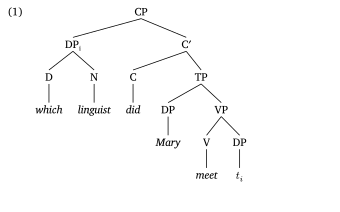{width=100%}
:::
::::
:::::

### Movement, the cheap way first

Most of the time an index and a trace are all you need, and that is still one set of brackets. Two things to know, and both are about how the content gets cut into nodes. `$t_i$` is ordinary math inside a node and needs nothing special. A subscript on a *nonterminal* does: `DP#sub[i]` has to be wrapped in its own content block, `#[DP#sub[i]]`, or the subscript is read as a second child and the node grows a branch to it. The apostrophe in `C'` has the same problem, because Typst turns it into a smart quote and splits it off, so type the prime character `C′` instead.

::::: {.column-page}
:::: {.grid}
::: {.g-col-12 .g-col-lg-6}
```typst
#example[_Which linguist did Mary meet?_

  #syntree(
    nonterminal: (font: "Charis SIL"),
    terminal: (font: "Charis SIL", style: "italic"),
    child-spacing: 1.8em,
    layer-spacing: 2.3em,
  )[
    [CP [#[DP#sub[i]] [D which] [N linguist]]
      [C′ [C did] [TP [DP Mary] [VP [V meet] [DP $t_i$]]]]]
  ]
]
```
:::
::: {.g-col-12 .g-col-lg-6}
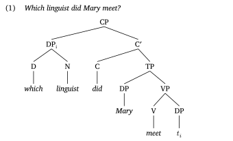{width=100%}
:::
::::
:::::

That is the version I use in handouts, and for most purposes it is enough.

### Arrows, and what Mal already worked out

Before writing any of this I went and read Malhaar Shah's *SynTeX* ([lingbuzz/008032](https://ling.auf.net/lingbuzz/008032)), which is the handout I would give anyone who asks how to draw syntax in LaTeX: numbered examples, glosses, arrows on sentences, arrows on trees, cyclic domains, feature matrices, multidominance, spanning. What follows is me going down that handout figure by figure and trying to get the same picture out of Typst. Most of them came out. The two that did not are at the end of this section.

The package doing the work is [`larrow`](https://typst.app/universe/package/larrow/), which draws an arrow between two Typst labels. It knows nothing about trees, which is why it composes with `syntree`, with a gloss, or with a bare sentence:

```typst
#import "@preview/larrow:1.2.0": label-arrow, arrow-label
```

One rule before anything else. **`larrow` needs a page with a fixed height.** It works out where a label is by subtracting from `page.height`, and `#set page(height: auto)` hands it `auto` to do arithmetic on. That is an error, not a warning, and the message (`type auto has no method to-absolute`) does not say the word `page`.

#### An arrow with no tree under it

Mal's first arrows are not on a tree at all. Alan Munn's `movement-arrows` puts a bracket under an example sentence, which is what you want on a handout when the tree would be beside the point. `larrow` will do it once you tell it the path. `bend` usually takes a number for curvature, but it also takes a function from the two endpoints to the points in between, and a bracket under a line is two points: straight down from the source, across, and up into the target.

::::: {.column-page}
:::: {.grid}
::: {.g-col-12 .g-col-lg-6}
```typst
#let bracket-arrow(from, to, label, depth: 16pt) = label-arrow(
  from, to, tip: ">",
  bend: ((f, t) => (
    (f.at(0), f.at(1) - depth.pt()),
    (t.at(0), t.at(1) - depth.pt()),
  )),
  caption: text(8pt)[#label],
)

#example[
  What#arrow-label(<landing>, dy: -3pt, dx: -10pt) did a famous linguist
  meet #strike[which linguist]#arrow-label(<trace>, dy: -3pt, dx: -50pt)?
]

#bracket-arrow(<trace>, <landing>, [_wh_-movement])
```
:::
::: {.g-col-12 .g-col-lg-6}
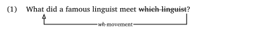{width=100%}
:::
::::
:::::

`arrow-label` rather than a plain `<label>`, because a plain label attaches itself to whatever Typst thinks the preceding element is, which on a line of prose is often the whole paragraph. `dy` moves the anchor: positive is up, negative is down. `#strike[...]` is the unpronounced copy, `\sout` in Mal's version.

`depth` is the only knob. Give a second arrow a bigger one and it sits under the first, which is how you get A-movement and *wh*-movement on the same sentence. Mal warns that the two labels then collide, and they collide here too; `caption-position` takes a ratio, so slide one of them off centre.

#### The same arrow on a tree

On a tree the two ends are nodes, and a label needs something to hang on. Put the node's content in a `#box[...]` and the label after it. Skip the box and `syntree` counts the label as another child and hangs an empty branch off the node, which is a confusing five minutes.

::::: {.column-page}
:::: {.grid}
::: {.g-col-12 .g-col-lg-6}
```typst
#example[
  #syntree(
    nonterminal: (font: "Charis SIL"),
    terminal: (font: "Charis SIL", style: "italic"),
    child-spacing: 1.8em,
    layer-spacing: 2.3em,
  )[
    [CP [#[DP#sub[i]] [D which] [N #box[linguist] <landing>]]
      [C′ [C did] [TP [DP Mary] [VP [V meet]
        [DP #box[$t_i$] <trace>]]]]]
  ]
]

#label-arrow(<trace>, <landing>, bend: -55, tip: ">",
  stroke: (thickness: 0.6pt, dash: "dashed"),
  caption: text(8pt)[_wh_-movement])
```
:::
::: {.g-col-12 .g-col-lg-6}
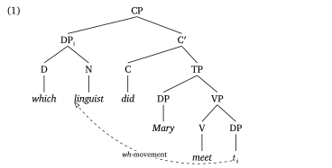{width=100%}
:::
::::
:::::

`bend` is a plain number here: negative curves left, positive curves right, and a bigger magnitude is a deeper swoop. `caption` is Mal's `node[pos=0.75, fill=white]{A-movement}` from TikZ, and it punches a hole in the line it sits on for free.

#### Dependencies, and features on a node

An agreement dependency is the same arrow with different ends. Mal uses TikZ's `[o-o]`; in `larrow` those are `tip` and `from-tip`, and they take any cetz mark name. The thing worth writing a helper for is that the two nodes are usually at different depths, so the bracket wants one floor rather than one measured from each end.

Feature matrices need no package at all. `mat(delim: "[", ...)` is `bmatrix`.

::::: {.column-page}
:::: {.grid}
::: {.g-col-12 .g-col-lg-6}
```typst
#let dependency(from, to, label, depth: 18) = label-arrow(
  from, to, tip: "o", from-tip: "o",
  stroke: (thickness: 0.6pt, dash: "dashed"),
  bend: ((f, t) => {
    let y = calc.min(f.at(1), t.at(1)) - depth
    ((f.at(0), y), (t.at(0), y))
  }),
  caption: text(8pt)[#smallcaps(label)],
  caption-options: (frame: none, padding: 3pt, anchor: "north"),
)

#let phi = text(9pt)[$mat(delim: "[",
  "case:", std.smallcaps("nom");
  "pers:", "3";
  "num:", std.smallcaps("sg"))$]

#example[
  #syntree(
    nonterminal: (font: "Charis SIL"),
    terminal: (font: "Charis SIL", style: "italic"),
    child-spacing: 1.6em,
  )[
    [S [NP [D the] [N #box[#stack(spacing: 0.4em, [linguist], phi)] <subj>]]
      [VP [V #box[walks] <verb>] [NP [D her] [N dog]]]]
  ]
]

#dependency(<subj>, <verb>, [subject–verb agreement], depth: 26)
```
:::
::: {.g-col-12 .g-col-lg-6}
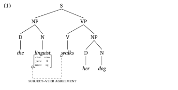{width=100%}
:::
::::
:::::

Two details in there earn their keep. `std.smallcaps` and not `smallcaps`, because inside math Typst looks in the math scope first and the error message tells you so. And `caption-options`, which is handed straight to cetz's `content`: without `anchor: "north"` the label sits on the line, and when the label is wider than the bracket it erases the bracket. Anchoring it north hangs it underneath instead.

#### Marking a domain

An arc marking a cyclic domain is the same call with no arrowhead. `tip: none` removes the head. `from-offset` and `to-offset` push each end away from the node it is anchored to, which is how you draw a line that starts and ends in empty space when you only have two real nodes to hang it on.

::::: {.column-page}
:::: {.grid}
::: {.g-col-12 .g-col-lg-6}
```typst
#example[
  #syntree(
    nonterminal: (font: "Charis SIL"),
    terminal: (font: "Charis SIL", style: "italic"),
    child-spacing: 1.6em,
  )[
    [S [NP [D the] [N dog]]
      [VP [#box[V]<v> barked] [#box[NP]<obj> [D the] [N mailman]]]]
  ]
]

#label-arrow(<v>, <obj>, tip: none, bend: -34,
  stroke: (thickness: 0.6pt, dash: "dashed"),
  from-offset: (30pt, 6pt), to-offset: (48pt, 6pt),
  caption: text(8pt)[cyclic domain], caption-position: "end",
  caption-options: (frame: none, padding: 5pt, anchor: "west"))
```
:::
::: {.g-col-12 .g-col-lg-6}
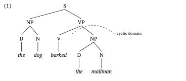{width=100%}
:::
::::
:::::

A label on a *nonterminal* goes on the tag itself, `#box[NP]<obj>`, and that one does not turn into an extra child.

#### Multidominance

Mal's multidominance trees rest on `forest`'s `phantom`: an invisible node that still occupies its width, so the second mother has somewhere to point. Typst has `hide()`, which does the same thing to content, but `syntree` draws the branch to a hidden child anyway and you get an edge going nowhere. Leave the phantom out and let the drawn line be the second edge:

::::: {.column-page}
:::: {.grid}
::: {.g-col-12 .g-col-lg-6}
```typst
#example[
  #syntree(
    nonterminal: (font: "Charis SIL"),
    terminal: (font: "Charis SIL", style: "italic"),
    child-spacing: 1.6em,
  )[
    [ConjP
      [S [^NP Sebastián] [#box[VP]<shared> [V loves]]]
      [Conj′ [Conj but]
        [S [^NP Mal] [VP [V hates] [#box[NP]<obj> birds]]]]]
  ]
]

#label-arrow(<shared>, <obj>, tip: none, bend: -18,
  stroke: 0.75pt,
  from-offset: (0pt, -7pt), to-offset: (0pt, 7pt))
```
:::
::: {.g-col-12 .g-col-lg-6}
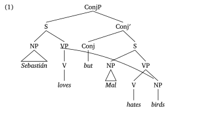{width=100%}
:::
::::
:::::

That is Mal's ConjP tree with fewer moving parts. What it loses is the width the phantom was reserving, so if the two conjuncts crowd each other, `child-spacing` is the knob.

#### The two that did not port

The spanning diagrams did not. Mal draws squiggly lines from several heads down to one exponent and a brace grouping them; cetz has a `wave` decoration and a `brace`, but `larrow` only exposes straight segments and beziers, so getting them means dropping to cetz and carrying the node positions down with you, which is the next section.

Neither did `forest`'s alignment controls. `calign=midpoint` with a stipulated primary and secondary child is what makes his scope-taking trees line up over an invisible daughter, and `syntree` centres a parent over its children with no say in the matter. If you need those trees, that is a reason to stay in `forest`.

### The escape hatch: drawing it yourself

`larrow` gives you a path between two labels. When what you want is not a path between two labels, three packages cooperate to hand you a real drawing surface with the tree's node positions inside it. Add to your preamble:

```typst
#import "@preview/lingotree:1.0.0": tree as ltree, render as lrender
#import "@preview/mannot:0.3.0": mark, annot-cetz
#import "@preview/cetz:0.4.2" as cetz
```

Each does one job. `lingotree` draws the tree, and unlike `syntree` it wants the tree taken apart into nested `ltree(tag: ..., ...)` calls instead of a bracket string. `mannot` puts a name on a node: `mark(tag: <trace>)[...]`. `cetz` draws a line between two names.

So build the smallest possible version first: a three-word tree, two marked nodes, and one straight line between them. Read `annot-cetz` as "given these two tags, draw this", and the drawing itself is a single `line` from the bottom of one to the bottom of the other.

::::: {.column-page}
:::: {.grid}
::: {.g-col-12 .g-col-lg-6}
```typst
#example[
  #lrender(
    ltree(
      tag: [TP],
      ltree(tag: [DP#sub[i]], mark(tag: <landing>)[Mary]),
      ltree(tag: [VP],
        ltree(tag: [DP], mark(tag: <trace>)[$t_i$]),
        ltree(tag: [V], [left]),
      ),
    ),
  )

  #annot-cetz(
    (<trace>, <landing>), cetz,
    {
      cetz.draw.line(
        "trace.south",
        "landing.south",
        stroke: (dash: "dashed"),
        mark: (end: "straight"),
      )
    },
  )
]
```
:::
::: {.g-col-12 .g-col-lg-6}
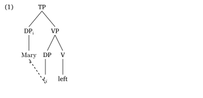{width=100%}
:::
::::
:::::

Now change exactly one thing. A straight line is fine when nothing sits between the trace and the landing site, and useless when something does. Swap `line` for `bezier-through`, which takes three points instead of two: start, a point to bend through, end. Everything else stays as it was.

::::: {.column-page}
:::: {.grid}
::: {.g-col-12 .g-col-lg-6}
```typst
#example[
  #lrender(
    ltree(
      tag: [CP],
      ltree(tag: [DP#sub[i]], mark(tag: <landing>)[which linguist]),
      ltree(tag: [C'],
        ltree(tag: [C], [did]),
        ltree(tag: [TP],
          ltree(tag: [DP], [Mary]),
          ltree(tag: [VP],
            ltree(tag: [V], [meet]),
            ltree(tag: [DP], mark(tag: <trace>)[$t_i$]),
          ),
        ),
      ),
    ),
  )

  #annot-cetz(
    (<trace>, <landing>), cetz,
    {
      cetz.draw.bezier-through(
        "trace.south",
        (rel: (x: -1.6, y: -0.55)),
        "landing.south",
        stroke: (dash: "dashed"),
        mark: (end: "straight"),
      )
    },
  )
]
```
:::
::: {.g-col-12 .g-col-lg-6}
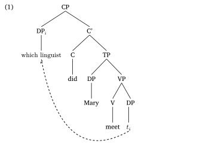{width=100%}
:::
::::
:::::

The middle point is the only line worth fiddling with. `(rel: (x: -1.6, y: -0.55))` is measured from the trace: negative `x` is left, negative `y` is down. More negative `y` gives a deeper swoop. The arrow is drawn on top of the layout rather than inside it, so if it runs off the bottom of the page, give the page a bigger bottom margin instead of adding blank lines.

## Semantics

### Denotation brackets, lambdas, and types

There is no `stmaryrd` to load. The brackets are built into Typst's math: `bracket.l.stroked` and `bracket.r.stroked`, wrapped in `lr()` so they grow with whatever is inside them. That is what the three `#let` lines above are for, and now the notation reads like the thing it means:

::::: {.column-page}
:::: {.grid}
::: {.g-col-12 .g-col-lg-6}
```typst
#example[
  $sem("every") = lam("P", lam("Q", forall x ["P"(x) -> "Q"(x)]))$ \
  $sem("runs") : ty(e, t)$
]
```
:::
::: {.g-col-12 .g-col-lg-6}
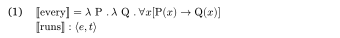{width=100%}
:::
::::
:::::

The logical vocabulary is all there under readable names: `forall`, `exists`, `not`, `and`, `or`, `->`, `<->`, `mapsto`, `iota`, `models`, `square`, `diamond.stroked`. Alternative sets and Hamblin sets are a matrix with a brace delimiter, `mat(delim: "{", ...)`.

### Derivations with rule labels

This is where I spent the most time, because the thing I want is the thing `align` in LaTeX makes hard: equals signs stacked vertically, rule names flush right, and the whole block sitting inside a numbered example.

A four-column grid does it. Add this to your preamble next to the other helpers:

```typst
#let derivation(..steps) = {
  set par(first-line-indent: 0em)
  let cells = ()
  for step in steps.pos() {
    let (lhs, op, rhs, label) = step
    cells.push(align(right, lhs))
    cells.push(op)
    cells.push(rhs)
    cells.push(align(right, text(size: 9pt, fill: luma(100))[#label]))
  }
  block(inset: (left: 0em, y: 0.3em))[
    #grid(columns: (auto, auto, 1fr, auto),
      column-gutter: 0.4em, row-gutter: 0.45em, ..cells)
  ]
}
```

Then each step is one line with four parts: left side, operator, right side, label. Leave the left side empty with `[]` when the step continues the one above it.

::::: {.column-page}
:::: {.grid}
::: {.g-col-12 .g-col-lg-6}
```typst
#example[$sem("Mary loves John")$

  #derivation(
    ($sem("loves John")$, $=$,
     $(lam("y", lam("x", "love"("x","y"))))(j)$, [by FA]),
    ([], $=>_beta$,
     $lam("x", "love"("x", j))$, [by $beta$-red.]),
    ($sem("Mary loves John")$, $=$,
     $(lam("x", "love"("x", j)))(m)$, [by FA]),
    ([], $=>_beta$,
     $"love"(m, j)$, [by $beta$-red.]),
  )
]
```
:::
::: {.g-col-12 .g-col-lg-6}
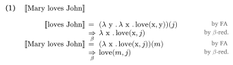{width=100%}
:::
::::
:::::

### Types and denotations on the nodes

A semantic tree wants types and denotations on the nodes, which means the nodes have to hold content and not just labels. The `tree()` function from `syntree` does that, and `\` inside a node is a line break, so a node carries a type on one line and a denotation on the next.

::::: {.column-page}
:::: {.grid}
::: {.g-col-12 .g-col-lg-6}
```typst
#example[
  #tree(
    [$t$ \ $"run"(m)$],
    tree([$e$ \ $m$], [_Mary_]),
    tree([$e -> t$ \ $lam("x", "run"("x"))$], [_runs_]),
  )
]
```
:::
::: {.g-col-12 .g-col-lg-6}
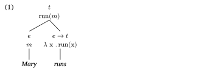{width=100%}
:::
::::
:::::

## Phonology

Everything above is syntax and semantics, but the best-organized linguistics package in Typst right now is a phonology one. [`phonokit`](https://typst.app/universe/package/phonokit/), by Guilherme D. Garcia, covers IPA, prosodic structure, autosegmental representations, SPE features, OT, Harmonic Grammar, and MaxEnt. One import gets you the pieces used below:

```typst
#import "@preview/phonokit:0.5.14": phonokit-init, ipa, feat, syllable, tableau
#phonokit-init(font: "Charis SIL")
```

### IPA and features

`#ipa()` takes tipa-style input, the same thing your fingers already know from LaTeX, and gives back real Unicode IPA. `#feat()` takes a comma-separated list and sets it as a feature matrix.

::::: {.column-page}
:::: {.grid}
::: {.g-col-12 .g-col-lg-6}
```typst
#example[
  + #ipa("'lINgwIst"), #ipa("SI'kagoU"), #ipa("'TINk")
  + #feat("+consonantal, –sonorant, –continuant, +voice") is the
    natural class of voiced stops.
]
```
:::
::: {.g-col-12 .g-col-lg-6}
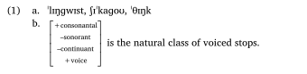{width=100%}
:::
::::
:::::

### Syllables

`#syllable()` draws onset-rhyme structure from a transcription, and works out the branching itself.

::::: {.column-page}
:::: {.grid}
::: {.g-col-12 .g-col-lg-6}
```typst
#example[
  #syllable("kat") #h(2em) #syllable("strEnT")
]
```
:::
::: {.g-col-12 .g-col-lg-6}
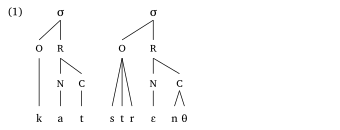{width=100%}
:::
::::
:::::

### OT tableaux

The tableau is the one that would take an afternoon by hand. You give it the input, the candidates, the constraints, and a grid of violations, with `!` marking the fatal one. It draws the double line after the input column, puts ☞ on the winner, and shades the cells that no longer decide anything: everything to the right of the last fatal violation.

::::: {.column-page}
:::: {.grid}
::: {.g-col-12 .g-col-lg-6}
```typst
#example[
  #tableau(
    input: "/kat+s/",
    candidates: ("kats", "kat", "katəs"),
    constraints: ("*Complex", "Max", "Dep"),
    violations: (
      ("*!", "", ""),
      ("", "*!", ""),
      ("", "", "*"),
    ),
    winner: 2,
  )
]
```
:::
::: {.g-col-12 .g-col-lg-6}
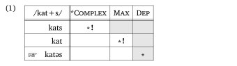{width=100%}
:::
::::
:::::

`winner: 2` counts from zero, so it is the third candidate. The package also has `#vowel-chart()`, `#consonant-table()`, `#autoseg()` for tone spreading, `#vot()` for VOT timelines, and MaxEnt and Harmonic Grammar tableaux that compute their own probabilities.

## Others

### Experiment figures without opening Keynote

Every procedure figure I have ever made was a box, an arrow, another box, and a caption, and I made all of them in something that was not the document. In Typst a box is `#block(stroke: ...)`, so the figure lives in the paper and changes when the paper does.

Two helpers do the work here: `frame` is a fixed-size bordered box, and `step` stacks a frame on top of its duration label.

::::: {.column-page}
:::: {.grid}
::: {.g-col-12 .g-col-lg-6}
```typst
#let frame(body) = block(
  width: 3cm, height: 1.9cm,
  stroke: 0.5pt + luma(140), radius: 2pt, inset: 6pt,
)[#align(center + horizon)[#body]]

#let step(body, dur) = stack(
  spacing: 0.45em,
  frame(body),
  align(center, text(8pt, fill: luma(110))[#dur]),
)

#let arrow = align(horizon, text(13pt, fill: luma(160))[#sym.arrow.r])

#grid(
  columns: (auto,) * 5,
  column-gutter: 0.7em,
  align: top,
  step([$+$], [500 ms]),
  arrow,
  step([_The key to the cabinets_], [self-paced]),
  arrow,
  step([Was the key rusty?], [until response]),
)
```
:::
::: {.g-col-12 .g-col-lg-6}
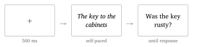{width=100%}
:::
::::
:::::

The same idea gets you the thing we usually paste in as a screenshot: a picture of the actual display. A screenshot is a fixed-width bitmap that goes soft in print, shows whatever your browser chrome looked like that day, and has to be retaken when you change the wording of a single instruction. Drawing it is nested blocks, and the numbers on the scale are `range(1, 8)` rather than seven copy-pasted boxes.

::::: {.column-page}
:::: {.grid}
::: {.g-col-12 .g-col-lg-6}
```typst
#let scale-box(n) = block(
  width: 1.6em, height: 1.6em,
  stroke: 0.5pt + luma(150), radius: 2pt,
)[#align(center + horizon)[#text(9pt)[#n]]]

#block(width: 100%, stroke: 0.6pt + luma(150), radius: 3pt)[
  #block(
    width: 100%, fill: luma(242), inset: (x: 0.8em, y: 0.45em),
    stroke: (bottom: 0.5pt + luma(205)),
  )[#text(8.5pt, fill: luma(95))[Acceptability judgments, trial 14 of 96]]

  #block(width: 100%, inset: 1.3em)[
    #align(center)[
      #text(13pt)[The key to the cabinets were rusty.]
      #v(1.1em)
      #text(9pt, fill: luma(110))[How natural does this sentence sound?]
      #v(0.6em)
      #grid(
        columns: (auto,) * 7, column-gutter: 0.45em,
        ..range(1, 8).map(n => scale-box(n)),
      )
      #v(0.35em)
      #grid(
        columns: (auto, 1fr, auto), column-gutter: 0.5em,
        text(7.5pt, fill: luma(130))[completely unnatural],
        [],
        text(7.5pt, fill: luma(130))[perfectly natural],
      )
    ]
  ]
]
```
:::
::: {.g-col-12 .g-col-lg-6}
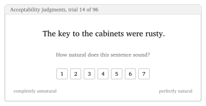{width=100%}
:::
::::
:::::

It is vector, so it stays sharp at any size, and when a reviewer asks what participants actually saw, the answer is in the same file as the paper.

### Bibliography

One line, pointed at the same `.bib` file you already have:

```typst
#bibliography("refs.bib", style: "american-psychological-association")
```

APA is built in under that name, and so are a few hundred others. What is not built in is anything specific to our field: `linguistic-society-of-america` is not a valid style name, and Typst will tell you so.

The fix is that Typst reads plain CSL files. Download the [Unified Style Sheet for Linguistics](https://github.com/citation-style-language/styles/blob/master/unified-style-sheet-for-linguistics.csl), the style behind the bibliographies in *Semantics and Pragmatics*, *Glossa*, and *Language*, drop the `.csl` next to your document, and point at the file instead of a name:

```typst
#bibliography("refs.bib", style: "unified-style-sheet-for-linguistics.csl")
```

`glossa.csl` is in the same repository if you want that one specifically. If you are submitting somewhere with house rules, check the output against the journal's own sample before you trust it.

Cite with `@rooth1992` for the parenthetical form. For "Rooth (1992)" in running text you need `#cite(<rooth1992>, form: "prose")`, which is too long to type fifty times, so define the two citation commands you actually use:

```typst
#let narr(key) = cite(key, form: "prose")        // Rooth (1992)
#let gen(key) = {                                 // Atlamaz's (2023)
  cite(key, form: "author")
  [\u{2019}s ]
  cite(key, form: "year")
}
```

### Things that will bite you

- `bracket.l.double` and `bracket.r.double` are deprecated. Use `bracket.l.stroked` and `bracket.r.stroked`.
- Do not paste the CJK characters 〚 〛 as a shortcut. They look right and they are not in Typst's set of math delimiters, so they will not scale or align.
- Gloss words need two or more spaces between them. One space silently merges them.
- Multi-letter words in math need quotes: `$"love"(x, y)$`, not `$love(x,y)$`.
- `syntree` 0.3 takes the tree as content in square brackets, not as a quoted string. Anything on the web written for 0.2 will not compile.
- A subscripted nonterminal is one content block, `#[DP#sub[i]]`. Loose, the subscript becomes a second child with a branch drawn to it.
- `C'` is a smart quote and splits the node in two. Type the prime, `C′`.
- `larrow` needs `#set page(height: ...)` with a real length. On `height: auto` it fails with `type auto has no method to-absolute`, which does not mention the page.
- A label inside a tree node needs a `#box[...]` to hang on, or it becomes another child. On a nonterminal, put it on the tag: `#box[NP]<obj>`.
- Inside math it is `std.smallcaps`, not `smallcaps`.
- `phonokit` defaults to a font called `Charis`, not `Charis SIL`. If you get "unknown font family" warnings, that is why: pass the name you actually have to `#phonokit-init(font: ...)`.
- If you do not have Charis SIL installed, delete the `font:` line and Typst uses its own default serif, which is fine. On typst.app you can upload a font file into the project instead.
- Pin package versions, which means writing `eggs:0.6.0` and not something vaguer. Your file will still compile after the package updates.

### When to stay with LaTeX

If the venue hands you a `.cls` file and expects the source, you are writing LaTeX. Same for a collaborator who will not switch, and for anything already half-written with `expex` or `linguex`. Typst has templates, but it does not have your journal's template.

What it is very good at right now: handouts, class notes, slides, squibs, dissertation chapters you control, and drafts you will move into a LaTeX template at the very end. That is most of what I write in a given month.

### Take the file

The [source of the guide](typst-for-linguists.typ) is one file, and the semantics half of this post is defined in the first hundred lines of it: the semantic brackets, the lambda helper, the type helper, the derivation grid, the tip and warning boxes, the citation commands. Delete the prose, keep the helpers, and you have a working preamble for a semantics paper. The `larrow` helpers above are newer than the PDF and are not in it yet; they will be in the syntax edition.

That edition is the next thing, along with glossing-heavy field methods material. If something here breaks or a package moves, tell me and I will fix the guide.
